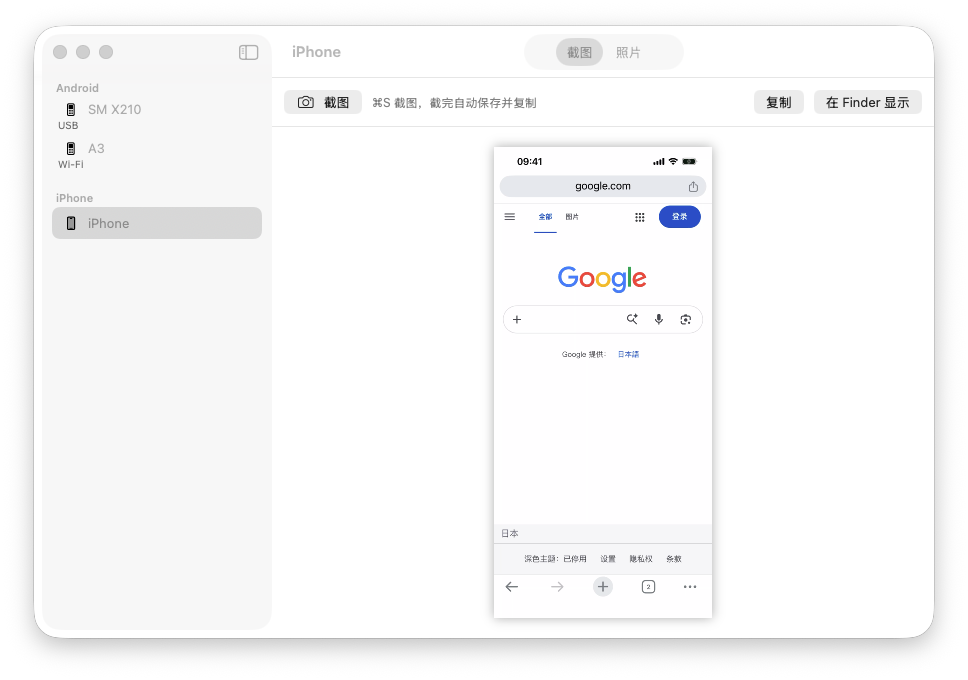

# PhoneBridge

A small native macOS app for the two things you keep opening Android Studio (or fumbling with your iPhone) for:

- **Screenshots** of any USB / adb-connected Android device, a HarmonyOS NEXT device over `hdc`, and a USB-connected iPhone. One click (or ⌘S): preview, saved to a folder, copied to the clipboard, drag it anywhere.
- **Files**: browse an Android device, drag files in to upload, download files and folders to your Mac. Import photos and videos from an iPhone.

No Xcode project, no dependencies beyond `adb` for Android and `hdc` for HarmonyOS NEXT.



> 中文说明见下方。

## Requirements

- macOS 14 or later. Tested on Apple Silicon (macOS 26); Intel is untested.
- Android: [platform-tools](https://developer.android.com/tools/releases/platform-tools) (`adb`) and USB debugging enabled
- HarmonyOS NEXT (Huawei phones on HarmonyOS 5 and later): `hdc` from the [HarmonyOS Command Line Tools](https://developer.huawei.com/consumer/cn/download/) or DevEco Studio and USB debugging enabled. The Command Line Tools download needs a Huawei developer login; without one, take the `toolchains` folder (it contains `hdc`) from the public OpenHarmony SDK, e.g. `https://repo.huaweicloud.com/openharmony/os/5.1.0-Release/L2-SDK-MAC-M1-PUBLIC.tar.gz` (Apple Silicon, about 1.3 GB), and put `hdc` on your `PATH`. Huawei devices on HarmonyOS 4 and earlier speak adb and show up under Android.
- iPhone: connected by USB and "Trust This Computer" accepted. No developer disk image and no sudo. The screen-capture channel is the one QuickTime uses, so developer mode should not be needed, but so far it has only been tested on a phone with developer mode on.

## Build and install

```sh
git clone <this repo> && cd phonebridge
scripts/build-app.sh --install     # builds build/PhoneBridge.app and copies it to /Applications
```

Requires the Swift toolchain that comes with Xcode or the Command Line Tools.

The build is signed with your first local "Apple Development" identity if you have one (set `PB_SIGN_IDENTITY` to pick another), otherwise ad-hoc. macOS ties the camera permission to the signature: with an ad-hoc signature it asks again after every rebuild.

## How it works

| | How |
|---|---|
| Android screenshot | `adb exec-out screencap -p` (multi-display devices get a display picker) |
| Android files | `adb shell stat` for listing, `adb push` / `adb pull` for transfer |
| HarmonyOS NEXT screenshot | `hdc shell snapshot_display -t png` to a temp file in `/data/local/tmp`, `hdc file recv`, then the temp file is deleted (JPEG fallback on systems without `-t`) |
| iPhone screenshot | The macOS USB screen-capture channel (the one QuickTime uses for iPhone recording), via CoreMediaIO + AVFoundation |
| iPhone photos | ImageCaptureCore (the framework behind Image Capture.app) |

Notes:

- **adb lookup**: GUI apps don't get your shell `PATH`, so PhoneBridge asks your login shell (`$SHELL -lc 'command -v adb'`) for `adb` and falls back to common install locations. Using the same `adb` as your terminal matters: a different `adb` version restarts the running adb server and drops wireless connections. You can set the path in Settings.
- **hdc lookup**: same order as adb (Settings path, login shell `PATH`), then a few common DevEco Studio / OpenHarmony SDK locations (not checked against every install; if it isn't found, put `hdc` on your `PATH` or set the path in Settings). Like adb, running `hdc` starts its server (port 8710) if none is running; PhoneBridge never kills or restarts it.
- **hdc reports failures with exit status 0** (only a `[Fail]` / `error:` line), so a HarmonyOS screenshot counts as done only when a decodable image actually arrived.
- **Never touches the adb server**: no `kill-server`, `connect`, `disconnect`. Files are only written where you drop or download them, plus a HarmonyOS screenshot's temp file on the device, deleted right after. There is no delete, rename or APK install on purpose.
- **iPhone status bar**: while its screen is being captured, iOS shows a clean status bar (9:41, full battery, full signal). Screenshots show that, not the real status bar.
- **Why the screen-capture switch stays on**: once the process that enabled it exits, the iPhone takes several seconds to reappear, so back-to-back screenshots would fail. PhoneBridge keeps it on while running, opens a capture session per screenshot and stops it right after.
- **Camera permission**: macOS treats the iPhone screen as a camera-class device, so the first iPhone screenshot asks for camera access. Nothing is recorded or uploaded.
- **Copying files to an iPhone** is not supported: Apple has no public API for it. Use AirDrop.
- **Same-name files are overwritten**, both when uploading to Android and when downloading to the Mac (that is what `adb push` / `adb pull` do).
- **iPhone photo library**: large libraries load in batches, the grid fills in over a few seconds. If the photo channel stops answering (seen after opening and closing it many times in a row), unlock the phone and re-plug the cable.

## Self test

```sh
open -W -n /Applications/PhoneBridge.app --args --selftest /tmp/pb-selftest
cat /tmp/pb-selftest/report.txt
```

Screenshots every connected device, does an upload / list / download round trip on each Android device (in `/sdcard/Download/phonebridge-selftest/`, removed afterwards), lists HarmonyOS NEXT devices found by `hdc`, opens the iPhone photo library, then quits. Unit tests: `swift test`.

For README-style screenshots, `open -n /Applications/PhoneBridge.app --args --demo` shows iPhones as just "iPhone", hides Android / HarmonyOS serials and IP addresses, and takes one iPhone screenshot.

## License

MIT

---

## 中文

PhoneBridge 是一个 macOS 小工具，用来替代「只为截图打开 Android Studio」：

- **截图**：USB / adb 连接的 Android 设备、hdc 连接的鸿蒙 NEXT 设备、USB 连接的 iPhone，点一下（或按 ⌘S）出预览，自动存到文件夹并复制到剪贴板，也可以直接把图拖走。Android 多屏设备（比如带副屏的机器）可以选截哪块屏，鸿蒙 NEXT 目前只截主屏。
- **传文件**：浏览 Android 设备里的文件，把 Mac 上的文件拖进去就上传，选中后下载到 Mac。iPhone 可以导入照片和视频。
- 保存目录在设置（⌘,）里改。
- 截图默认缩到长边 1000 像素再保存和复制，贴给 AI 省 token（2000×1314 的原图约省四分之三）；设置里可以改成 1568 / 1280 / 768 或原图。

安装：`scripts/build-app.sh --install`，装到「应用程序」，之后像普通 App 一样打开、关闭。

需要知道的：

- iPhone 截图走 macOS 自带的 USB 屏幕采集（QuickTime 录 iPhone 屏用的就是它），不用 sudo。理论上不需要开发者模式，但目前只在开着开发者模式的手机上测过。第一次会请求摄像头权限。
- iPhone 截图里的状态栏是系统替换后的（9:41、满电、满信号），不是真实状态栏。
- 不支持往 iPhone 里传文件，苹果没有公开接口，请用 AirDrop。
- 同名文件会被覆盖（上传到 Android、下载到 Mac 都是）。
- iPhone 照片多时分批加载，几秒内陆续补全；如果照片一直读不出来，解锁手机、拔插一次数据线。
- 不会动 adb 服务（不执行 kill-server / connect / disconnect），也没有删除、重命名、装 APK 功能。
- 鸿蒙 NEXT（HarmonyOS 5 及以后的华为设备）要装 `hdc`（HarmonyOS Command Line Tools 或 DevEco Studio 自带；前者下载要登录华为开发者账号，没有账号可以从华为云镜像下载 OpenHarmony 公开 SDK，例如 Apple 芯片用 `https://repo.huaweicloud.com/openharmony/os/5.1.0-Release/L2-SDK-MAC-M1-PUBLIC.tar.gz`，约 1.3 GB，解出里面的 toolchains，把 `hdc` 放进 PATH 或在设置里填路径），手机打开「USB 调试」并点「允许」。鸿蒙 4 及更早的华为设备走 adb，显示在 Android 分组里。
- 鸿蒙截图会在手机 `/data/local/tmp` 写一个临时文件，拉回后立即删除；运行 hdc 时如果它的服务没开会自动启动（和 adb 一样），PhoneBridge 不会关闭或重启它。
